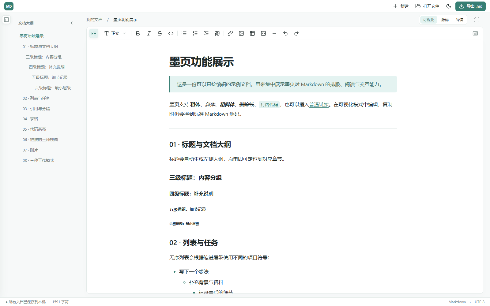

# 墨页功能展示

> 这是一份可以直接编辑的示例文档，用来集中展示墨页对 Markdown 的排版、阅读与交互能力。

墨页支持 **粗体**、*斜体*、***粗斜体***、~~删除线~~、`行内代码`，也可以插入[普通链接](https://github.com/mrqf000/moye-markdown-editor)。在可视化模式中编辑，复制时仍会得到标准 Markdown 源码。

---

## 01 · 标题与文档大纲

标题会自动生成左侧大纲，点击即可定位到对应章节。

### 三级标题：内容分组

#### 四级标题：补充说明

##### 五级标题：细节记录

###### 六级标题：最小层级

## 02 · 列表与任务

无序列表会根据缩进层级使用不同的项目符号：

- 写下一个想法
  - 补充背景与资料
    - 记录最后的细节
- 把内容交给 AI 协作完善

有序列表同样支持多级结构：

1. 整理目标
   1. 描述读者
   2. 明确交付形式
2. 编写与修改
3. 保存为 Markdown

任务列表可以直接勾选：

- [x] 打开一个 Markdown 文件
- [x] 在可视化页面中编辑
- [ ] 邀请 Agent 参与下一步工作

## 03 · 引用与分隔

> 好的工具应该让格式自然发生，让注意力回到内容本身。
>
> 引用可以包含多个段落，也可以作为文章中的重点提示。

---

## 04 · 表格

表格支持选择单元格、整行或整列，也可以插入、删除和拖动调整宽高；超出编辑区时仅表格区域横向滚动。

| 能力 | 可视化操作 | Markdown 表达 | 状态 |
| --- | --- | --- | --- |
| 标题与正文 | 工具栏切换层级 | `#` 到 `######` | 已支持 |
| 列表与任务 | 类型互相转换、缩进 | `-`、`1.`、`- [ ]` | 已支持 |
| 表格 | 行列选择、增删、调节大小 | GFM 表格 | 已支持 |
| 代码 | 自动识别语言、语法高亮、换行 | 围栏代码块 | 已支持 |

## 05 · 代码高亮

```javascript
const editor = {
  name: "墨页",
  modes: ["可视化", "源码", "阅读"],
  localFirst: true,
};

console.log(`${editor.name}：让 Markdown 更容易阅读与编辑。`);
```

```python
def collaborate(person, ai):
    return person.idea + ai.suggestion
```

## 06 · 链接的三种视图

标题视图就是普通 Markdown 链接：

[墨页 Markdown 编辑器](https://github.com/mrqf000/moye-markdown-editor)

卡片视图会保留标题、来源和地址：

[墨页 Markdown 编辑器 · GitHub](https://github.com/mrqf000/moye-markdown-editor)

<!-- moye-view:card -->

展示视图可以尝试直接预览网页或受支持的视频；是否能够内嵌取决于来源网站：

[每天15分钟 get 一眼万年的丝滑美背｜哔哩哔哩](https://www.bilibili.com/video/BV1Gz421C7G1/)

<!-- moye-view:embed -->

## 07 · 图片

可以通过图片链接插入，也可以直接从剪贴板粘贴图片。粘贴的图片会保存在 Markdown 文档自身的数据中。



## 08 · 三种工作模式

- **可视化模式**：直接看到排版结果并进行编辑。
- **源码模式**：查看和修改完整 Markdown 源码。
- **阅读模式**：隐藏编辑操作，专注阅读内容。

---

示例结束。你可以任意修改这份文档，再复制其中的内容，检查得到的是否仍是清晰、可移植的 Markdown。

